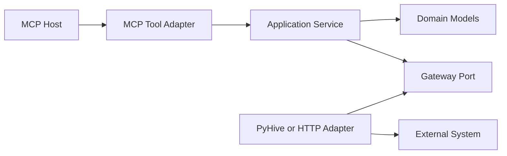

# Architecture and Modules

## Purpose and Authority

This document describes the package structure, module responsibilities, dependency direction, and extension rules for the plugin-based MCP stdio runtime.

The active OpenSpec proposal, specs, design, and tasks are the normative source of truth. This document is an explanatory architecture view and must be synchronized after approved OpenSpec changes.

The fixed registry contains delivered Hive, Zeppelin, DolphinScheduler and Spark slices. The active Spark download and inspection changes govern acquisition and read-only local evidence selection.

## Architectural Style

The project is a modular monolith with vertical plugin slices and Clean Architecture dependency direction.



Dependencies point toward application and domain policy. External systems and MCP are adapters around the application core.

This is intentionally “Clean Architecture Lite”: responsibilities and import rules are strict, but v1 avoids a deeply nested directory for every conceptual layer.

## Concentric Circle Layering

The runtime is Clean Architecture concentric circles: dependencies point inward; an outer circle may know an inner circle, never the reverse.

| Circle (outer → inner) | Modules |
| --- | --- |
| Frameworks & Drivers | `httpx`, `websockets`, `mcp`/`FastMCP`, `pydantic`, `pyhive`, argparse, asyncio, stdio transport, MCP host process, Hive/Zeppelin upstream servers |
| Interface Adapters | Inbound: `core/server.py`, `tools.py` · Outbound: `http_client.py`, `websocket_client.py`, `plugins/hive/pyhive.py` · Config: `core/config.py`, `plugins/*/config.py` · Ports: `gateway.py`, `contracts/plugin.py` |
| Use Cases / Application | `service.py` |
| Entities / Domain | `models.py`, `core/errors.py` |

Composition roots (`bootstrap.py`, `registry.py`, `plugin.py`) sit at the outermost edge and may import any inner circle to wire adapters to use cases at startup; every other module obeys inward-only dependency. `gateway.py` and `contracts/plugin.py` are port contracts — the dependency-inversion boundary between use cases and adapters.

### Inbound to outbound trace

A tool request crosses every circle from the MCP host to the upstream system and back. Using the Zeppelin `add_paragraph` tool as the example:

```text
① Frameworks & Drivers  MCP host process ──stdin JSON-RPC──►
② Frameworks & Drivers  FastMCP.run_stdio_async()  decodes JSON-RPC, dispatches tool call
③ Interface Adapters    core/server.py StdioMcpServer   registered tool, delegates
④ Interface Adapters    tools.py ZeppelinToolAdapter    MCP args → service call
⑤ Use Cases             service.py add_paragraph        validate opaque ID/title/body, parse shebang
⑤ Use Cases             service.py (inline gate)         interpreter allowlist + SQL write-target / sh-command safety
⑥ Port contract         gateway.py ZeppelinGateway.add_paragraph   ← dependency-inversion boundary
⑦ Interface Adapters    http_client.py ZeppelinHttpClient   translate to POST /api/notebook/{id}/paragraph
⑧ Frameworks & Drivers  httpx.AsyncClient                actual TCP/TLS/socket I/O
⑨ Frameworks & Drivers  Zeppelin REST server              external system
```

The response returns through the same layers in reverse, each adapter translating back toward the MCP host:

```text
⑨ Zeppelin response
  ← ⑧ httpx.Response
  ← ⑦ http_client.py  parse JSON → domain models, truncate bytes, map exceptions → ZeppelinGatewayError
  ← ⑥ port returns ParagraphStatus, etc.
  ← ⑤ service.py  assemble AddParagraphResult
  ← ④ tools.py  domain model → MCP result
  ← ③ server.py
  ← ② FastMCP  serialize JSON-RPC
  ← ① stdout ──► MCP host process
```

### Startup wiring

Before any request, the composition root wires every adapter to its use case in a single pass:

```text
bootstrap.py (parse_args) → registry.py (select zeppelin) → plugin.py (_create_runtime):
  core/config.py load_config → config.py ZeppelinSettings/ZeppelinSecrets   [config adapter]
  ├─► http_client.py ZeppelinHttpClient(settings)        [outbound adapter]
  ├─► service.py ZeppelinNotebookService(gateway, …)     [use case]
  └─► tools.py ZeppelinToolAdapter(service)              [inbound adapter]
  → core/server.py StdioMcpServer(runtime) → FastMCP.run_stdio_async()      [driver]
```

### Dependency direction enforcement

The inward dependency rule is enforced by `tests/contract/test_architecture.py` via `tests/contract/import_rules.py`, which defines four rules:

- **core-to-plugin**: `core.*` must not import any `plugins.*`.
- **service-to-infrastructure**: a `*.service` module must not import external client/MCP libraries or HTTP/plugin/tool/file adapters, including Spark files/cache. Hive's existing pure domain cache remains an application dependency.
- **shared-to-plugin**: only `registry.py` may import a concrete plugin from shared code.
- **plugin-to-plugin**: one plugin must not import another.

The use-case layer (`service.py`) therefore sees only ports (`gateway.py`) and domain models (`models.py`); it never imports `httpx`, `FastMCP`, or `http_client.py`. Swapping an HTTP library or MCP framework changes one adapter, leaving use cases and domain models untouched.

## Process and Package Boundaries

There is one installable Python distribution and one `mcp-stdio` entry point. At runtime, each child process loads exactly one built-in plugin.

```text
One installed package
└── mcp-stdio entry point
├── process A: shared runtime + Hive plugin
├── process B: shared runtime + Zeppelin plugin
├── process C: shared runtime + DolphinScheduler plugin
└── process D: shared runtime + Spark plugin
```

The package boundary simplifies installation and versioning. The process boundary isolates credentials, failures, connections, caches, and mutable state.

Spark persistent evidence permits sequential reuse of one dedicated directory with a process lock; it does not share live clients or credentials.

## Planned Source Layout

```text
src/mcp_stdio/
├── __init__.py
├── __main__.py
├── bootstrap.py
├── registry.py
│
├── core/
│   ├── config.py
│   ├── errors.py
│   ├── logging.py
│   └── server.py
│
├── contracts/
│   └── plugin.py
│
└── plugins/
    ├── hive/
    │   ├── plugin.py
    │   ├── config.py
    │   ├── models.py
    │   ├── service.py
    │   ├── gateway.py
    │   ├── pyhive.py
    │   └── tools.py
    ├── zeppelin/
    │   ├── plugin.py
    │   ├── config.py
    │   ├── models.py
    │   ├── service.py
    │   ├── gateway.py
    │   ├── http_client.py
    │   ├── websocket_client.py
    │   └── tools.py
    ├── dolphinscheduler/
        ├── plugin.py
        ├── config.py
        ├── service.py
        ├── gateway.py
        ├── http_client.py
        └── tools.py
    └── spark/
        ├── plugin.py
        ├── config.py
        ├── models.py
        ├── gateway.py
        ├── service.py
        ├── http_client.py
        ├── files.py
        ├── cache.py
        ├── inspection_models.py
        ├── inspection_reader.py
        ├── inspection_events.py
        ├── inspection.py
        ├── metrics_models.py
        ├── metrics_events.py
        ├── metrics.py
        └── tools.py
```

Files may become subpackages when they grow, but their responsibility and dependency direction must remain unchanged.

## Shared Runtime Modules

| Module | Responsibility | Allowed dependencies | Must not know about |
| --- | --- | --- | --- |
| `__main__.py` | Console entry point; delegates to bootstrap | `bootstrap` | Backend APIs and business behavior |
| `bootstrap.py` | CLI parsing, composition, lifecycle, cleanup | `core`, `contracts`, `registry`, MCP SDK | PyHive statements or REST endpoint details |
| `registry.py` | Explicit mapping of fixed plugin names to factories | Concrete `plugin.py` modules | Dynamic module names or filesystem discovery |
| `core/config.py` | Safe YAML/JSON loading (optional file), versioning, env-var-only startup, prefix overrides, secret references | Standard library, Pydantic, PyYAML | Plugin tool behavior or network clients |
| `core/errors.py` | Stable safe error categories and correlation metadata | Standard library/domain types | Raw backend-specific responses |
| `core/logging.py` | stderr logging and redaction | Standard library | MCP stdout writing |
| `core/server.py` | FastMCP stdio lifecycle, raw declared-argument validation and safe errors | MCP SDK, Pydantic, plugin contract | Concrete backend adapters |
| `contracts/plugin.py` | Minimal plugin construction, registration, and cleanup protocol | Shared types only | Concrete backend details |

## Plugin Module Pattern

Every plugin follows the same responsibility pattern without sharing backend-specific abstractions.

| Module | Clean Architecture role | Responsibility |
| --- | --- | --- |
| `plugin.py` | Composition root | Validate plugin config, construct adapter/service, register tools, close resources |
| `config.py` | Boundary model | Define non-secret settings and secret references for that backend |
| `models.py` | Domain | Represent normalized requests, results, states, and metadata |
| `service.py` | Application | Implement use cases using gateway interfaces and domain models |
| `gateway.py` | Outbound port | Define the operations the application needs from the backend |
| `pyhive.py` / `http_client.py` | Outbound adapter | Translate the gateway operations to PyHive or REST calls |
| `tools.py` | Inbound adapter | Define MCP tool schemas and convert between MCP values and application models |

The plugin contract governs lifecycle only. It does not create a generic database or REST abstraction. Each backend keeps its own gateway vocabulary.

## Dependency Rules

### Allowed

```text
__main__ -> bootstrap
bootstrap -> core + contracts + registry
registry -> plugins.<name>.plugin
plugins.<name>.plugin -> plugin-local modules + contracts
plugins.<name>.tools -> plugin service + domain models + MCP SDK
plugins.<name>.service -> plugin gateway + domain models
plugins.<name>.external_adapter -> plugin gateway + external library
```

### Forbidden

```text
core -> plugins
service -> FastMCP
service -> PyHive
service -> httpx
hive -> zeppelin or dolphinscheduler
zeppelin -> hive or dolphinscheduler
dolphinscheduler -> hive or zeppelin
caller-controlled name -> importlib import
```

Architecture tests must scan imports and fail when these boundaries are violated.

## Plugin Lifecycle Contract

The minimal contract supports these phases:


A plugin provides:

- a canonical fixed name;
- plugin-specific configuration validation;
- construction of gateway adapter and application service;
- registration of its exact MCP tool set;
- idempotent asynchronous cleanup.

The contract does not support dynamic installation, hot reload, cross-plugin calls, or loading multiple plugins into one server.

## Hive Module Responsibilities

- `config.py` models binary Thrift/LDAP settings and cache TTL.
- `models.py` contains database, table, column, partition-column, and schema results.
- `service.py` implements list-database, list-table, and get-schema use cases plus cache coordination.
- `gateway.py` exposes only fixed metadata operations; it has no execute-SQL method.
- `pyhive.py` validates/quotes identifiers, generates approved statements, manages one connection per uncached call, and parses rows.
- `tools.py` exposes exactly three structured read-only MCP tools.

The cache is plugin-local. It may use shared generic utilities only if those utilities contain no Hive policy.

## Zeppelin Module Responsibilities

> **Delivered** by `deliver-zeppelin-plugin-slice`.

- `config.py` models base URL, authentication references, timeouts, result limits, the interpreter allowlist, the SQL write-allowed databases, and the sh allowed commands.
- `models.py` contains notebook IDs, paragraph IDs, normalized states, bounded outputs, safe failures, and the pure validation functions for SQL write targets, sh commands, and interpreter shebang parsing.
- `service.py` enforces use-case sequencing and the write-safety gate (interpreter allowlist, SQL write-target database check, sh command allowlist) before the external adapter receives paragraph content.
- `gateway.py` describes notebook tree listing, notebook creation, paragraph creation, execution, status, and result retrieval.
- `http_client.py` owns authentication/session state, URL encoding, REST translation, response bounds, `trust_env=False`, and cleanup.
- `tools.py` exposes exactly nine tools: `list_notebooks`, `create_notebook`, `add_paragraph`, `run_paragraph`, `get_paragraph_status`, `get_paragraph_result`, `cancel_paragraph`, `get_interpreter_bindings`, `restart_interpreter`.
- `models.py` also owns immutable interpreter-binding records and the four-field restart result; `gateway.py` includes discovery and optional notebook-context restart.
- `service.py` checks exact opaque setting IDs against the independent restart allowlist before network work, and decorates `restart_allowed` locally.
- `http_client.py` owns notebook readability checks, fresh private session tickets, one overall deadline and HTTP/WebSocket composition. It serializes discovery, fresh selected membership enforcement and the single contextual PUT under its lock and deadline, and retains only a per-call secret guard until restart output validation. Before client creation it invokes the shared core policy that silences only HTTPX/httpcore transport logs, without changing root logging or storing transient secrets globally. `websocket_client.py` owns isolated binding queries, strict frame/byte/message bounds, secret-safe parsing and bounded cancellation/shutdown cleanup; no receive task survives built-in transport cleanup.

The MCP host connection is local JSON-RPC over stdio. Zeppelin HTTP and authenticated WebSocket connections are outgoing upstream adapters, not an MCP listener. Only a terminal `/api` is mapped to `/ws`, preserving the origin/proxy prefix. Omitted/null notebook context preserves legacy setting-wide restart; contextual failure cannot fall back or repeat the PUT. Notebook context does not isolate a shared interpreter process, and restart never automatically executes paragraphs.

The interpreter is parsed from the paragraph body's leading `%<interpreter>` shebang and matched against the configured allowlist; the tool never injects or modifies the shebang. Write-safety rules are enforced at `add_paragraph` time, before the body is sent upstream.

## DolphinScheduler Module Responsibilities

The delivered slice owns status inspection and constrained scheduling.

- `config.py` models base URL, fixed status path, authentication references, and timeout.
- `service.py` implements status, bounded enumeration/search/inspection/logs/link extraction and constrained workflow start.
- `gateway.py` exposes fixed scheduling operations and no caller-selected generic HTTP method.
- `http_client.py` calls the configured status endpoint and normalizes bounded safe fields.
- `tools.py` registers get_server_status, list_objects, get_object, search_objects, start_workflow, get_task_log and extract_log_links.

The configured status path is deployment input, not MCP caller input.

## Spark Module Responsibilities

- config.py owns seven settings (including default-on verify_tls and same-origin knox_sso_url) and environment Cookie or paired username/password references.
- models.py owns strict FetchRequest and immutable file/fetch results; gateway.py owns lookup/download/close and safe errors.
- service.py validates requests and decides reuse versus refresh under one deadline.
- http_client.py performs one lazy, bounded verified HTTPS GET; files.py validates ZIP/JSONL identities, redacts records and computes digests.
- cache.py implements the gateway, owns the private root lock and acquisition workers, and publishes one directory/manifest per download. It verifies exact-source/scope manifests and file hashes for reuse.
- inspection_models.py owns strict InspectRequest/QueryRequest and named inspection/query results; gateway.py adds the read-only SparkInspectionGateway inspect/query/close port.
- service.py also owns SparkInspectionService request validation, total deadlines and safe inspection/query errors; it depends on the port, not local file adapters.
- inspection_reader.py verifies one explicitly selected manifest/attempt in a single scan; inspection_events.py projects direct IDs, selected redacted text and bounded head/tail details.
- files.py and inspection_reader.py constrain record reads by the remaining aggregate byte budget plus one overflow byte, without a separate line-size cap. The acquisition output retains its independent aggregate size check.
- inspection.py implements SparkInspectionAdapter, full-file counters, bounded evidence selection and own-field query pagination without relation propagation or a persistent index.
- metrics_models.py owns strict Stage/Task requests and named metric results; metrics_events.py extracts six fixed metrics, success-attempt samples and nearest-rank statistics; metrics.py performs transient Stage aggregation and selected-group distributions with bounded rankings.
- service.py owns SparkMetricsService, depending on SparkMetricsGateway stage_metrics/task_distribution ports, not file adapters. plugin.py supplies the same SparkInspectionAdapter to inspection and metrics services; its existing worker set and close owns all local scans.
- tools.py exposes fetch_spark_event_log, inspect_spark_event_log, query_spark_events, get_spark_stage_metrics and get_spark_task_distribution; plugin.py composes dependencies under the existing single directory owner and closes acquisition/inspection work before releasing it.
- skills/spark-diagnosis/SKILL.md consumes those capabilities for agent-side hypotheses and counterevidence; installers distribute its canonical file without registering a Spark server.

No object store, persistent analysis index, TTL, GC or generic storage interface is introduced. Files/cache adapters are infrastructure and cannot be imported by the Spark service. All plugin imports remain within the slice; only registry imports its concrete composition root from shared code.

## Cross-Cutting Policies

### Configuration

Shared configuration code handles the optional file format, version, unknown-field rejection, environment-variable-only startup, prefix overrides (`<PREFIX>_<FIELD>`), generic overrides (`MCP_STDIO__SETTINGS__<FIELD>`), and secret references. Environment variables take precedence over file values. Each plugin owns its settings schema and declares its prefix. Configuration validation makes no network requests.

### Errors

External adapters convert transport-specific failures into plugin/domain failures. The MCP boundary converts those failures into the stable shared error categories and redacts unsafe details.

### Logging

Only `core/logging.py` configures application logging and the HTTPX/httpcore transport-log suppression policy. Startup and adapter-owned client creation invoke that shared policy; it silences only those transport namespaces and their children without changing root logging or retaining transient secrets. Application logs go to stderr. Modules receive or obtain named loggers but do not configure stdout handlers.

### Concurrency

REST adapters use asynchronous HTTP clients. Synchronous PyHive calls run in worker threads. Mutable sessions are not shared across processes, and Hive sessions are not shared across concurrent calls.

### Dependency management

uv manages the Python 3.10+ project and committed lockfile. A package imported directly by project code must be declared directly in `pyproject.toml`.

## Testing Boundaries

```text
Application unit tests
  -> fake gateway; no MCP or upstream client

Adapter tests
  -> fake PyHive cursor/connection or HTTP mock transport

MCP contract tests
  -> real tool registration and serialization; fake application gateway

Subprocess smoke tests
  -> real mcp-stdio stdin/stdout lifecycle

Opt-in integration tests
  -> explicitly configured real backend
```

Required structural checks include:

- shared core has no concrete plugin imports;
- application services import no MCP or external client libraries;
- plugins do not import one another;
- the registry contains only approved built-in names;
- each plugin registers its exact approved tool set.

## Adding Future Behavior

New tools, authentication modes, transports, third-party plugins, or generic endpoint/query features require a new or updated OpenSpec change before code is modified. The change must update capability specs first, then this document if module boundaries or dependency direction change.

Spark HTTP owns the optional Knox Basic-to-Cookie exchange. Only the SSO POST receives
Basic Authorization; the download GET receives scoped cookies. Acquired cookie values
are returned as private per-acquisition redaction context to the cache adapter, not as MCP data.
