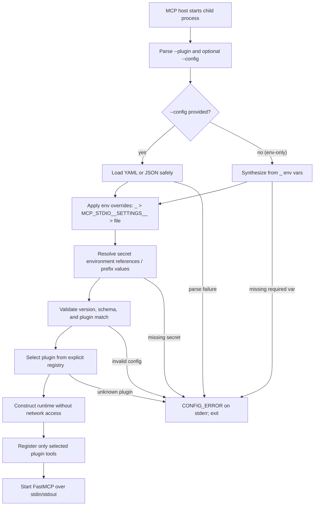
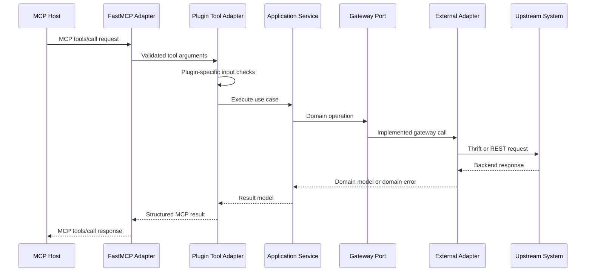
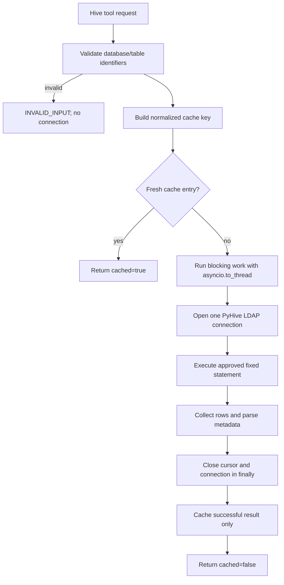
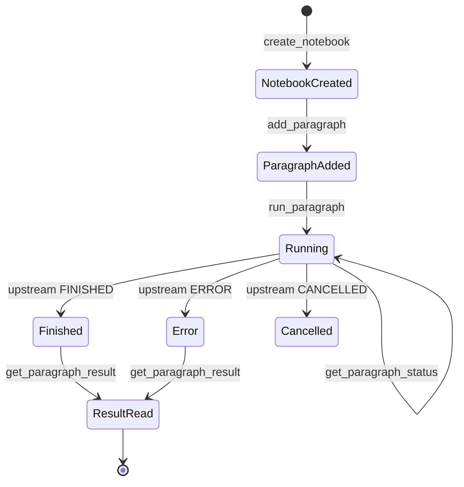
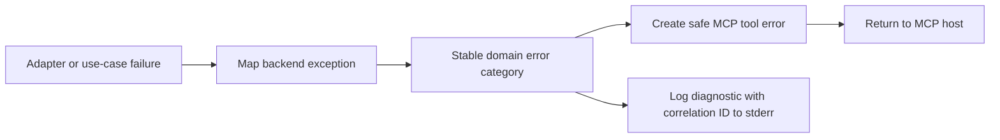

# MCP stdio Runtime Flow

## Purpose and Authority

This document explains how the plugin-based MCP stdio runtime starts, handles requests, reaches upstream systems, reports failures, and shuts down.

The active OpenSpec change remains normative:

- `openspec/changes/support-env-var-configuration/` (configuration source and precedence)
- `openspec/specs/plugin-stdio-runtime/spec.md` (synced main spec)
- `openspec/changes/build-plugin-mcp-stdio/` (multi-plugin runtime, partially deferred)
- `openspec/changes/deliver-zeppelin-plugin-slice/` (Zeppelin notebook tools and write-safety)
- `openspec/changes/add-spark-event-log-download/` (Spark acquisition, local evidence and raw argument validation)

If this document differs from an active OpenSpec artifact, update the OpenSpec artifact first and then synchronize this explanation.

## Process Topology

The MCP host launches one child process for every configured plugin instance. `core` and `contracts` are Python modules loaded inside each child process; they are not separate services.

```text
MCP Host
│
├── mcp-stdio --plugin hive [--config hive.yaml]   # --config optional; HIVE_* env vars may supply everything
│     └── Hive plugin ── PyHive/Thrift/LDAP ── HiveServer2
│
├── mcp-stdio --plugin zeppelin [--config zeppelin.yaml]   # --config optional; ZEPPELIN_* env vars may supply everything
│     └── Zeppelin plugin ── HTTP / WebSocket ── Zeppelin Server
│
├── mcp-stdio --plugin dolphinscheduler [--config dolphinscheduler.json]
│     └── DolphinScheduler plugin ── REST ── DolphinScheduler
│
└── mcp-stdio --plugin spark [--config spark.yaml]
      └── Spark plugin ── HTTPS ── Spark History Server
            └── private local JSONL + manifest (persistent L3)
```

Every child process owns its stdio channel, configuration, credentials, clients and live state. Spark permits sequential reuse of a dedicated persistent directory after the previous owner exits; a root lock prevents concurrent owners, and source/request matching prevents cross-source adoption.

The fixed registry contains the delivered Hive, Zeppelin, DolphinScheduler and Spark plugins. Every process loads only its selected plugin.

## Startup Flow



Startup validation is local. An unreachable HiveServer2 or REST server does not prevent the MCP process from starting; the first tool call that needs the backend reports the connection failure.

### Startup invariants

- No plugin is imported from caller-controlled module text.
- Plugin import and runtime construction perform no network request.
- The CLI plugin and configuration plugin must match.
- Unknown configuration fields fail closed.
- Secret fields contain environment variable names, not credential values.
- stdout remains reserved for MCP protocol messages.

## Common Tool Request Flow



The application service does not know about FastMCP, PyHive, or HTTP. It works with domain models and gateway interfaces, which allows unit tests to use fake gateways.

Before SDK argument preprocessing, the stdio boundary validates the original argument dictionary against the declared tool model. Unknown arguments and strict-type violations yield fixed INVALID_INPUT errors without input values. tools/list publishes closed input schemas.

## Hive Request Flow

Hive is metadata-only. It never accepts SQL text from the MCP caller.



Approved statement families are `SHOW DATABASES`, `SHOW TABLES`, `DESCRIBE`, and optional `SHOW CREATE TABLE`. Each uncached invocation owns one connection; concurrent requests do not share a Hive session.

## Zeppelin Request Flow

Zeppelin is execution-capable and therefore has a stricter trust boundary. The Zeppelin plugin is **delivered** by `deliver-zeppelin-plugin-slice`.



`add_paragraph` parses the interpreter from the paragraph body's leading `%<interpreter>` shebang, matches it against the configured allowlist, and enforces write-safety rules (SQL write-target database allowlist, sh command allowlist) before sending paragraph content upstream. `run_paragraph` starts execution and returns promptly; it does not poll until completion. The MCP client controls polling through `get_paragraph_status`, then retrieves bounded output with `get_paragraph_result`.

Opaque notebook and paragraph IDs are size-checked and URL-encoded. Large output is truncated to the configured limit and marked with `truncated: true`.

### Interpreter discovery and restart

The Zeppelin process exposes nine tools, including `cancel_paragraph`, `get_interpreter_bindings` and `restart_interpreter` in addition to the six lifecycle tools above.

```text
get_interpreter_bindings(notebook_id)
  -> validate opaque ID locally
  -> acquire serialized discovery slot within one overall deadline
  -> HTTP verify readable notebook with matching ID (discard content)
  -> obtain fresh private session ticket
  -> derive same-origin /api -> /ws, HTTP(S) -> WS(S)
  -> query GET_INTERPRETER_BINDINGS on one isolated outgoing socket
  -> bound/validate response, discard extra/auth fields, close socket
  -> return notebook_id + bindings (setting_id/name/interpreters/selected/restart_allowed)
```

Discovery needs neither execution nor restart permission. `restart_allowed` is the exact local ID allowlist decision, not upstream authorization or health. Select the exact returned ID with `selected=true` and `restart_allowed=true`; pass it with the same notebook ID to restart. Execution interpreter names and restart setting IDs have independent default-deny allowlists.

The service checks the local restart allowlist before any network call. The HTTP gateway serializes fresh discovery, selected membership enforcement and one HTTP PUT with `{"noteId": notebook_id}`. Its overall deadline includes lock waiting, precheck, ticket, socket query and PUT. Omitted/null notebook context explicitly retains legacy setting-wide PUT with no body/discovery. Failures never drop context, retry/reconnect a PUT, or automatically execute paragraphs. A four-field `setting_id/name/group/status` result acknowledges reported state only; a shared interpreter process can affect other notebooks.

Local MCP transport remains JSON-RPC over stdio. HTTP and WebSocket are outgoing Zeppelin connections, with no MCP HTTP/SSE/WebSocket listener. An ambiguous REST mount fails before network access rather than guessing a route. Success, failure, cancellation and shutdown close built-in streams/sockets within the configured cleanup allowance, terminate receive tasks and close the owned HTTP session. Discovery is serialized per plugin process and tickets are never cached between queries. The query authentication envelope is released after its socket closes; contextual restart retains only a call-local secret guard through success-result validation, then clears it on every outcome. Application logging setup and the adapter before HTTP client creation apply the shared HTTPX/httpcore wire-log suppression policy; root logging and safe application diagnostics remain unchanged. Both restart modes reject configured/session secrets in public strings, including response-installed cookies; contextual mode also checks its query-scoped secret values.

## DolphinScheduler Request Flow

The delivered DolphinScheduler plugin exposes get_server_status, list_objects, get_object, search_objects, start_workflow, get_task_log and extract_log_links. Its status flow is:

```text
get_server_status
  -> read configured base URL and status path
  -> attach environment-backed authentication internally
  -> call the fixed configured endpoint
  -> normalize availability, status, version, and safe details
  -> discard raw headers, cookies, tokens, and unbounded bodies
```

The MCP caller cannot select an HTTP method, URL, path or headers. Scheduling inputs follow the active scheduling capability specs.

## Spark Request Flow

```text
fetch_spark_event_log(application_id, attempt_id=None, refresh=False)
  -> strict input validation and one total deadline
  -> exact source/application/attempt lookup unless refresh=true
  -> verified cache hit returns existing paths and original download time
  -> otherwise serialize one bounded HTTPS GET with environment Cookie
  -> private .part directory: ZIP CRC/JSONL/identity validation and credential redaction
  -> source/output digests, event counts and ApplicationEnd observation
  -> write one manifest, remove ZIP, rename the whole directory
  -> return JSONL + manifest paths
```

Startup acquires a local exclusive directory lock without connecting upstream. TLS defaults to verified with optional trusted CA; explicit deployment verify_tls=false skips certificate and hostname verification; redirects, ambient proxy/CA overrides and retries are excluded. Optional paired Basic credentials trigger one same-origin Knox SSO POST before the download GET; both share the deadline. No startup or cache-hit login occurs. Cookie jars clear on receive exit, while acquired values are used only for the current evidence redaction. All available attempts are separate files; none is automatically selected as latest. Malformed tails and compressed/rolling event logs fail.

Evidence persists until user cleanup. Refresh creates another directory; there is no TTL, deduplication or GC. Cancellation/failure deletes only the call's unpublished directory. Shutdown cancels and awaits owned acquisition workers before closing the HTTP client and releasing the root lock. Force-kill remnants are ignored .part directories for manual cleanup.

## Error Flow



Stable categories are:

- `CONFIG_ERROR`
- `INVALID_INPUT`
- `AUTHENTICATION_FAILED`
- `PERMISSION_DENIED`
- `NOT_FOUND`
- `CONNECTION_FAILED`
- `TIMEOUT`
- `UPSTREAM_ERROR`
- `UNEXPECTED_RESPONSE`

Returned errors may contain an operation, safe object identifiers, retryability, and a correlation ID. They must not contain credentials, authorization headers, cookies, raw client objects, stack traces, or unbounded upstream bodies.

## Shutdown Flow

Shutdown starts when stdin reaches EOF, the MCP session is cancelled, startup fails after resource creation, or the host terminates the child process normally.

```text
Stop accepting MCP work
  -> allow the active request to finish or cancel it
  -> close plugin-owned WebSocket queries/receive tasks and HTTP client/session state
  -> close any active cursor/connection in its existing finally path
  -> flush redacted stderr logs
  -> exit child process
```

Stopping one plugin process has no effect on other independently launched plugin processes.

## Runtime Verification

The implementation must provide automated evidence for:

- exact tool sets per plugin;
- no network access during configuration validation;
- protocol-only stdout and logs on stderr;
- secret-safe errors through the actual MCP serialization path;
- cleanup on success, failure, cancellation, and EOF;
- Hive connection isolation and cache behavior;
- subprocess startup and shutdown behavior.

Zeppelin write-safety and DolphinScheduler scheduling contracts have their own suites. Spark adds synthetic archive/redaction, exact cache-scope/lock, real stdio download/reuse and opt-in live-download checks.
